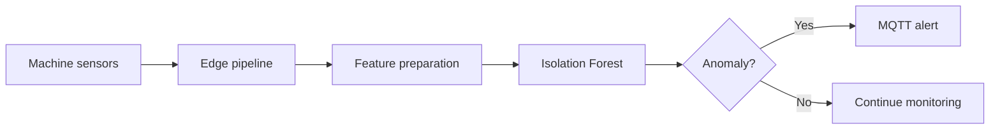

# AI-Based IIoT Anomaly Detector

A lightweight industrial monitoring prototype that detects abnormal machine behaviour from temperature, vibration, and current measurements and publishes alerts through MQTT.

## Highlights

- Processes more than **5,000 simulated sensor samples**.
- Uses an unsupervised **Isolation Forest** model.
- Connects edge-side detection with MQTT alert delivery.
- Achieved **below 300 ms alert latency** in the tested prototype setup.

## Architecture



## Stack

Python, scikit-learn, Isolation Forest, Pandas, NumPy, MQTT, and paho-mqtt.

## Quick start

```bash
python -m venv .venv
source .venv/bin/activate  # Windows: .venv\Scripts\activate
pip install pandas numpy scikit-learn paho-mqtt
python ai_agent.py
```

An MQTT broker must be available and its settings must match the project configuration.

## Engineering choices

- Unsupervised learning suits environments with normal operating data but limited labelled failures.
- Isolation Forest is lightweight enough for edge prototyping.
- MQTT keeps messaging overhead small and separates inference from downstream consumers.

The reported sample count and latency describe the tested prototype environment and should be re-measured after deployment changes.

## Author

**Samarth Patel** — Industrial AI · Edge Systems · Machine Learning · MQTT
